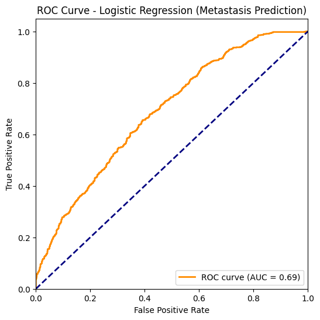
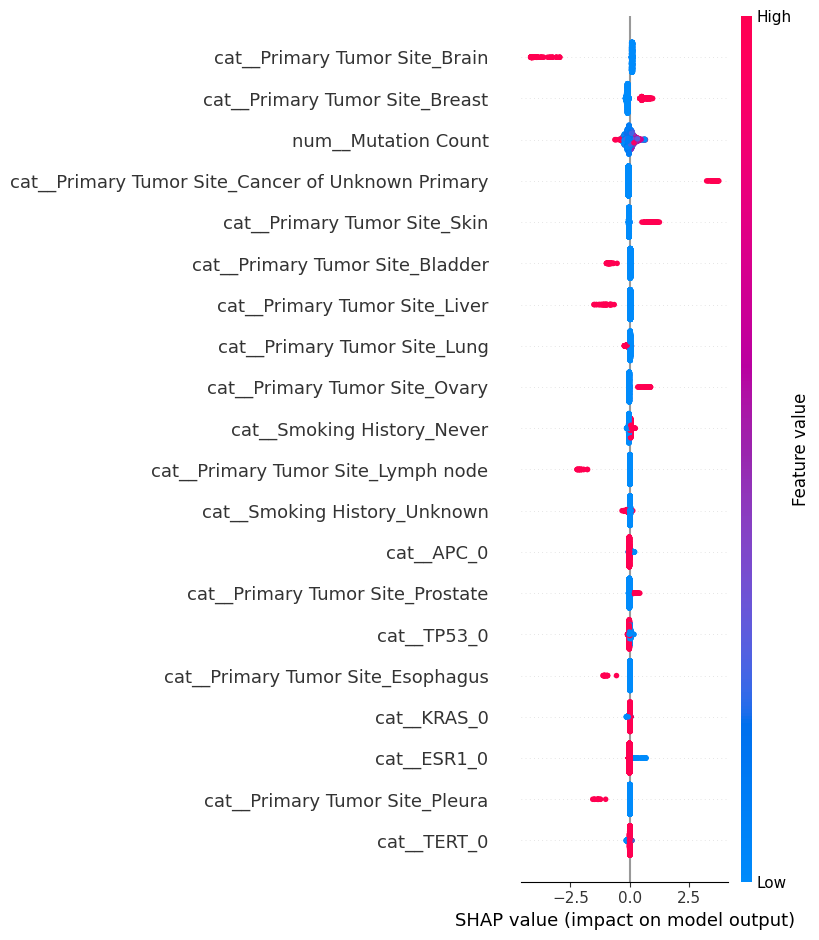
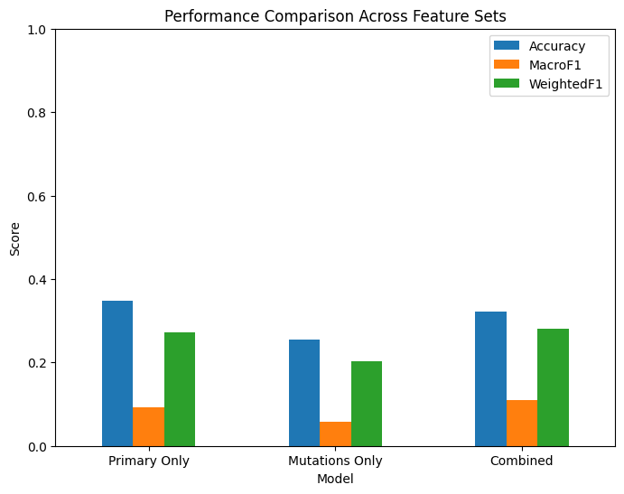
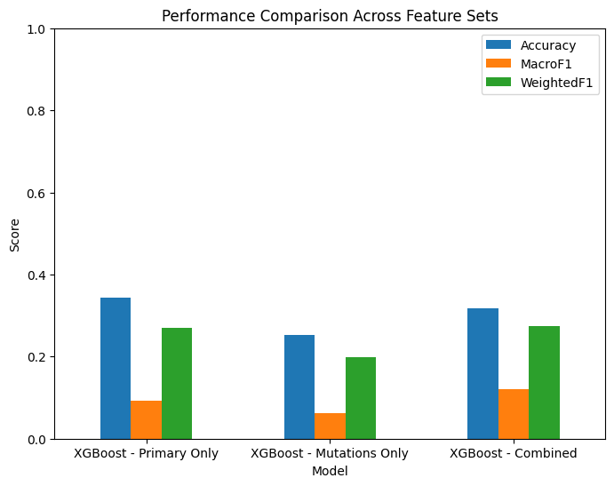
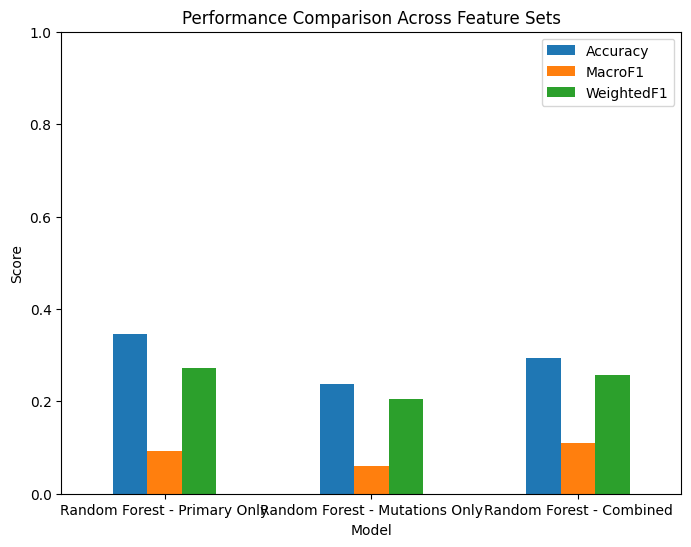
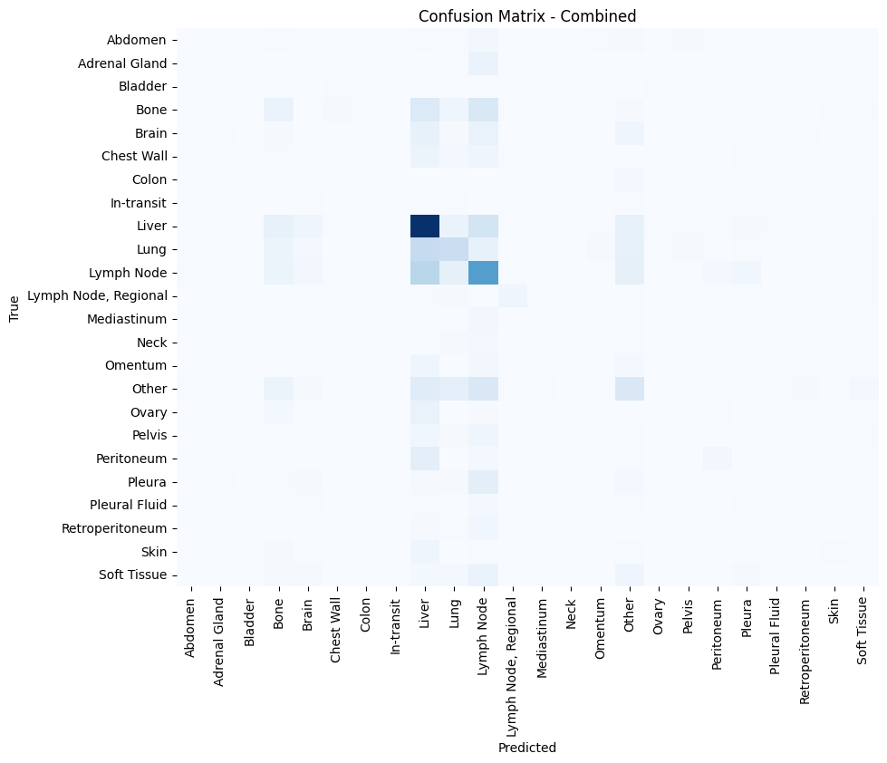
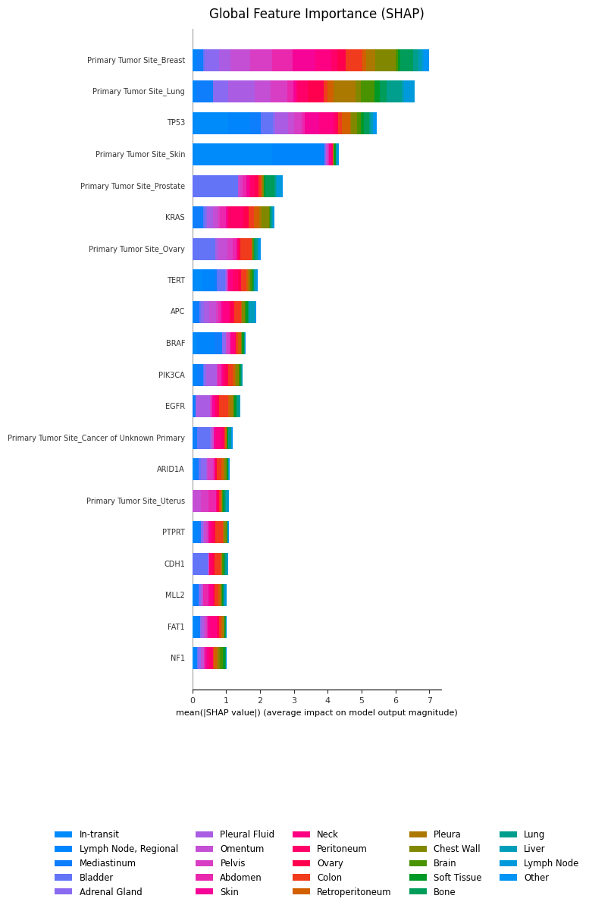
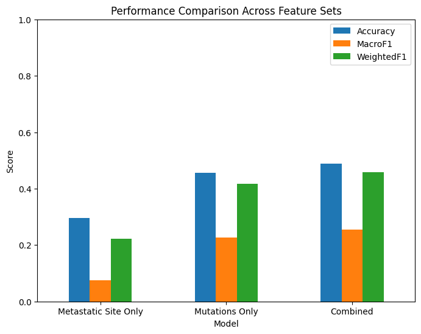
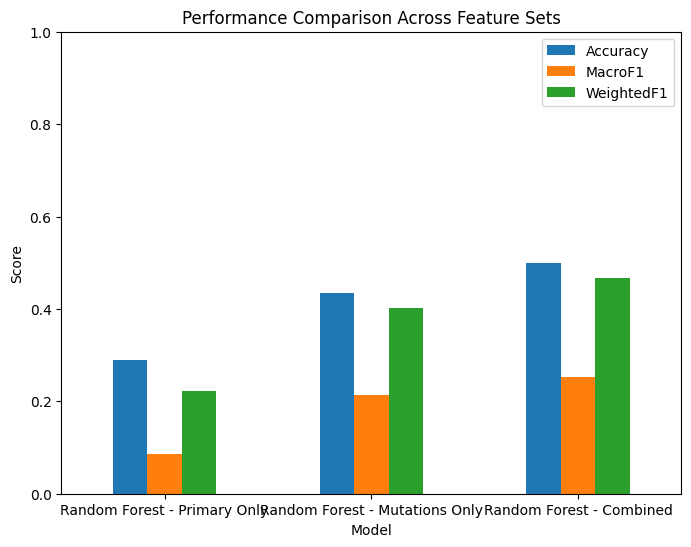
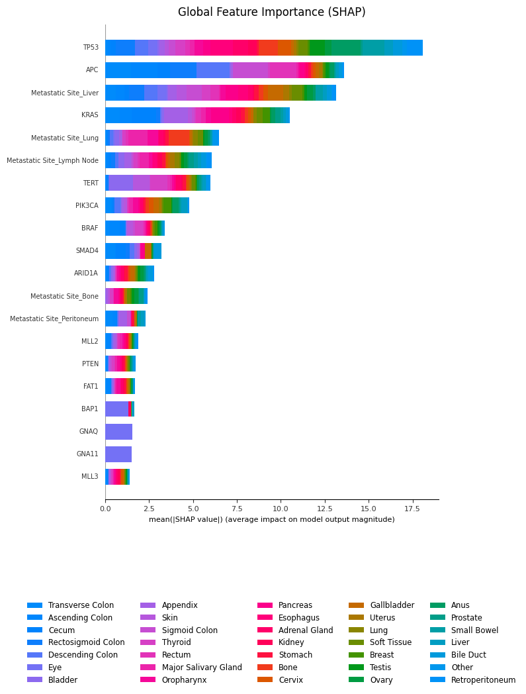

# Predicting metastasis and metastatic organotropism in malignancies using machine learning

Code behind my MSc thematic paper in Biomedical and Health Informatics at Mahidol University (2026).
The paper itself is not published here — this repository is the analysis: the notebook that produced
the results, the figures, and enough notes to reproduce the run.


## The question

Metastasis prediction is usually studied one cancer type at a time. This project asks whether a single
pan-cancer model can learn anything useful from primary tumour site and somatic mutation profile, and
it does so from three angles:

1. **Binary** — is this sample a primary tumour or a metastasis?
2. **Forward organotropism** — given a primary tumour, which organ does it metastasise to?
3. **Reverse** — given a metastatic site, which primary tumour did it come from? This is the
   cancers-of-unknown-primary problem, and it is where the models do best.

Six architectures are compared: logistic regression, XGBoost, random forest, SVM, a dense MLP, and a
TabTransformer. Each numeric model is run against three feature blocks — primary (or metastatic) site
alone, mutations alone, and both — so the comparison shows what each block contributes, not just which
model wins.

## Headline results

- **Reverse prediction works.** Random forest on metastatic site plus mutations reaches **50.0%**
  accuracy over 34 primary-site classes, where the majority-class baseline is 19.4%. Mutations carry
  most of the signal here.
- **Binary prediction is moderate.** XGBoost reaches **AUROC 0.707** (accuracy 0.635) separating
  primary from metastatic samples.
- **Forward prediction is weak.** The best combined model reaches **32.3%** accuracy over 24
  metastatic-site classes, where the majority-class baseline is 23.4%. Macro-F1 stays near 0.1 because
  the models collapse onto liver, lymph node and lung.

The thesis reports the same story with a blunter conclusion: DNA-seq plus basic clinical features are
not enough to say where a tumour will spread, but they do carry signal for detecting metastasis and for
working backwards to the primary site.

## What's in here

| Path | Contents |
| --- | --- |
| `notebooks/metastasis-organotropism.ipynb` | The full analysis: all three tasks, six models, feature-block comparison, SHAP |
| `figures/` | Twelve figures exported from the recorded run, referenced below |
| `data/README.md` | Where the MSK-IMPACT files come from and what to name them |
| `requirements.txt` | Python dependencies |

The notebook is a cleaned copy of the final working file (April 2026). Outputs, debug cells and
duplicated cells were removed, hard-coded paths were replaced with a configurable `data/` directory,
deprecated scikit-learn arguments were updated, and a handful of bookkeeping bugs were fixed —
SMOTE results were being dropped from their comparison chart, and one deep-learning cell used `device`
before defining it. The modelling logic is unchanged. It has **not** been re-executed end to end after
cleaning, so treat the numbers here as the recorded run, not a fresh benchmark.

## Data

The study uses the public **MSK-IMPACT 2017** cohort (Zehir et al., *Nature Medicine*, 2017) via
cBioPortal: 10,129 samples with both clinical attributes and mutation calls, 27 clinical columns plus
414 genes.

- Study: [`msk_impact_2017`](https://www.cbioportal.org/study/summary?id=msk_impact_2017)
- Bulk files: [cBioPortal datahub](https://github.com/cBioPortal/datahub/tree/master/public/msk_impact_2017)

The data is **not** redistributed here — it is large, it is versioned upstream, and it carries its own
terms of use. Put the two files in `data/` (or point `MSK_DATA_DIR` elsewhere) as described in
[`data/README.md`](data/README.md). Everything in `data/` is git-ignored.

## Method

**Cohort.** For the forward and reverse tasks the sample is restricted to metastatic biopsies: 4,486
cases. Metastatic sites with fewer than 20 cases are merged into `Other`, giving **24 classes** for the
forward task; primary sites are merged the same way for the reverse task. `Cancer of Unknown Primary`
and `Unknown` are dropped from the reverse task's target. The binary task uses all 10,129 samples.

**Features.** A binary gene-by-sample mutation matrix pivoted from the MAF, one-hot encoded primary or
metastatic site, and mutation count. Models are fitted on an 80/20 stratified split (`random_state=42`):
898 test samples for the multiclass tasks, 2,026 for the binary one.

**Models.** Logistic regression, XGBoost, random forest and linear SVM for the three feature blocks; a
dense MLP and a TabTransformer over the combined representation. Reverse adds Bernoulli naive Bayes as
a baseline. Class imbalance is handled with class weights, and a separate SMOTE experiment resamples
the training split only.

**Metrics.** Accuracy alongside macro-F1 and weighted F1, plus the no-information rate (NIR) for the
forward task, because accuracy alone is misleading on a cohort this imbalanced.

## Results

### Binary: primary vs metastasis (2,026 test samples)

| Model | Accuracy | Weighted F1 | AUROC |
| --- | ---: | ---: | ---: |
| Logistic regression (balanced) | 0.625 | 0.626 | 0.687 |
| XGBoost (class-weighted) | 0.635 | 0.636 | **0.707** |




SHAP puts primary site first but ranks mutation count and several genes (APC, TP53, KRAS, ESR1, TERT)
inside the top 20, with directions that match known biology — APC and KRAS pulling towards
colorectal-type patterns.



### Forward: primary → metastatic site (24 classes, NIR 0.234)

| Model | Site only | Mutations only | Combined |
| --- | --- | --- | --- |
| Logistic regression | 0.347 / 0.092 | 0.255 / 0.057 | 0.323 / 0.109 |
| XGBoost | 0.343 / 0.092 | 0.252 / 0.062 | 0.318 / 0.120 |
| Random forest | 0.346 / 0.092 | 0.237 / 0.060 | 0.294 / 0.110 |
| SVM | 0.347 / 0.092 | 0.259 / 0.077 | 0.302 / 0.126 |

<sub>Accuracy / macro-F1. MLP: 0.24 accuracy, 0.110 macro-F1. TabTransformer: 0.335 accuracy, 0.252
weighted F1 (52-class space, so not directly comparable).</sub>







Site alone outperforms mutations alone and adding mutations does not help — the opposite of the
reverse task. The confusion matrix shows why the averages look flat: almost everything is predicted
into a handful of large classes.





### Reverse: metastatic site → primary (34 classes, NIR 0.194, 856 test samples)

| Model | Site only | Mutations only | Combined |
| --- | --- | --- | --- |
| Logistic regression | 0.296 / 0.074 | 0.457 / 0.227 | 0.489 / 0.256 |
| XGBoost | 0.277 / 0.064 | 0.445 / 0.221 | 0.491 / 0.254 |
| Random forest | 0.289 / 0.085 | 0.433 / 0.214 | **0.500** / 0.253 |
| SVM | 0.294 / 0.086 | 0.411 / 0.230 | 0.449 / 0.255 |

<sub>Accuracy / macro-F1. Naive Bayes: 0.19 accuracy. MLP: 0.43 accuracy, 0.239 macro-F1.
TabTransformer: 0.31 accuracy.</sub>





Mutations do the heavy lifting in this direction, which makes sense: the metastatic site says little on
its own, but the mutation profile carries tissue-of-origin information. SHAP still ranks TP53 and APC
above most sites.



### SMOTE

Oversampling the training split did not rescue the forward task: accuracy fell for every model
(logistic 0.213, XGBoost 0.248, random forest 0.219, SVM 0.189) while macro-F1 rose slightly to
0.11–0.14, the usual trade of head-class accuracy for rare-class recall. On the reverse task it was
neutral to worse: XGBoost held at 0.485, random forest fell from 0.500 to 0.454.

## Reproducing

```bash
python -m venv .venv
source .venv/bin/activate
pip install -r requirements.txt

# put the two MSK-IMPACT files in ./data (see data/README.md)
jupyter lab notebooks/metastasis-organotropism.ipynb
```

Run the notebook top to bottom. Helpers (`evaluate_model`), encoders and resampled arrays carry over
between sections, so out-of-order execution will break. The forward and reverse sections each reload
the raw files, which is why loading code appears three times.

Optional environment variables:

- `MSK_DATA_DIR` — where the two input files live (default `data/`)
- `MSK_OUTPUT_DIR` — where derived CSVs and the SHAP PNG are written (default `outputs/`)

Training the TabTransformer and the MLPs is the slow part; the rest finishes in minutes.

## Limitations

- **Sample-level split, not patient-level.** MSK-IMPACT contains multiple samples per patient, so the
  same patient can appear on both sides of the split. A grouped split would be stricter and would
  likely lower the scores.
- **The label is the biopsied site**, not a full metastatic map. A patient with liver and bone lesions
  may appear once, under one site.
- **Heavy class collapse.** Merging rare sites into `Other` makes the task tractable but hides exactly
  the rare-organotropism cases a clinical model would need to get right.
- **No external validation.** All results are a single hold-out split of one cohort.
- **Two thesis analyses are not in this notebook**: the sensitivity analysis over different class
  thresholds, and the comparison of site-specific with pan-cancer models. They are reported in the
  thesis only.

## Status and licence

The thesis is still being finalised, so the document, defence slides and committee material are not in
this repository. Code and figures are shared for reading and reference. No open-source licence has been
applied yet — if you want to reuse or build on this, please get in touch first.

Ching To Chung · MSc Biomedical and Health Informatics, Mahidol University, 2026
