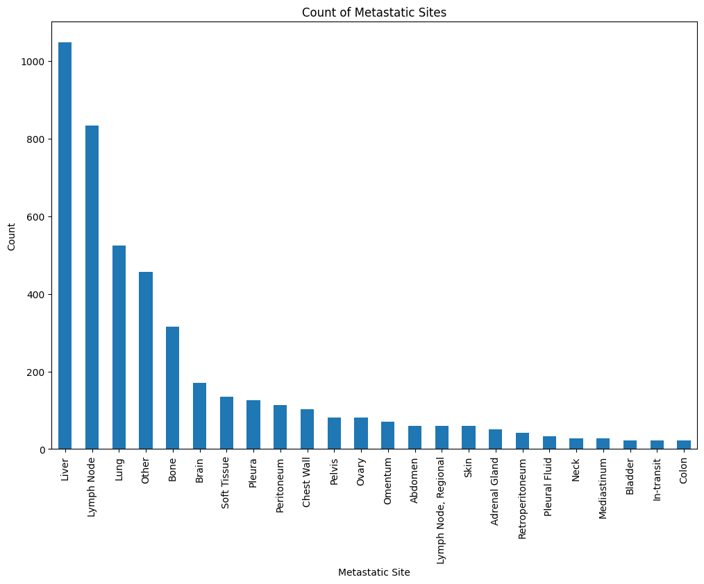
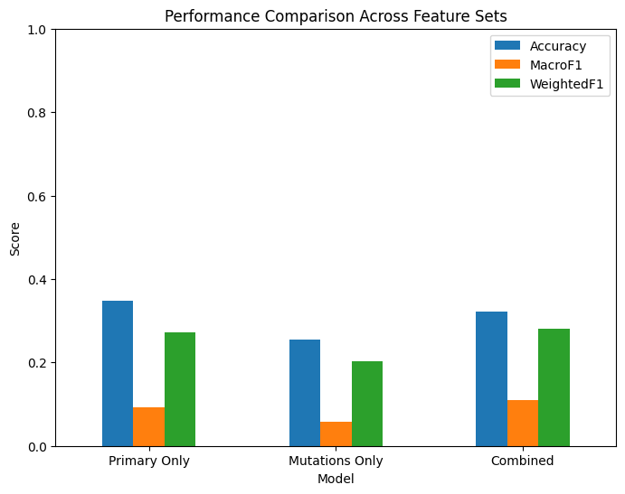
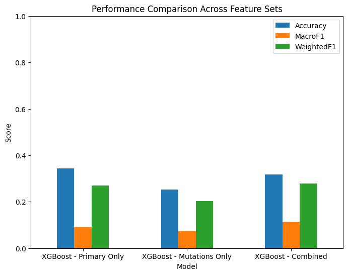
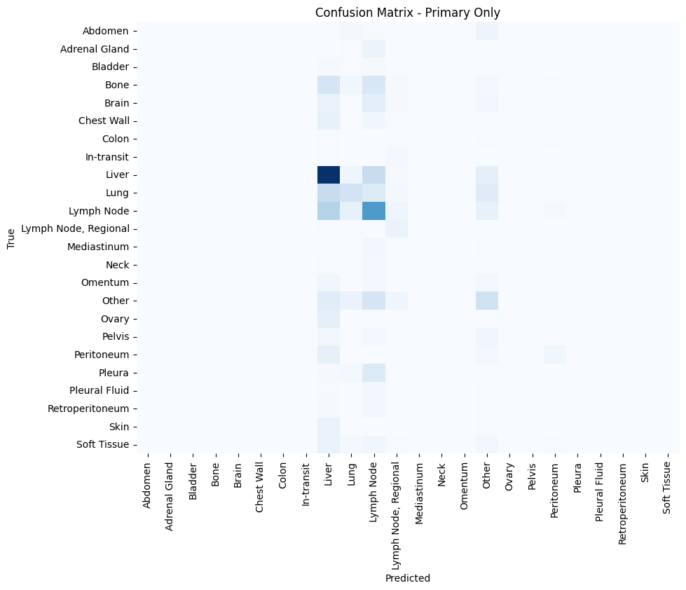
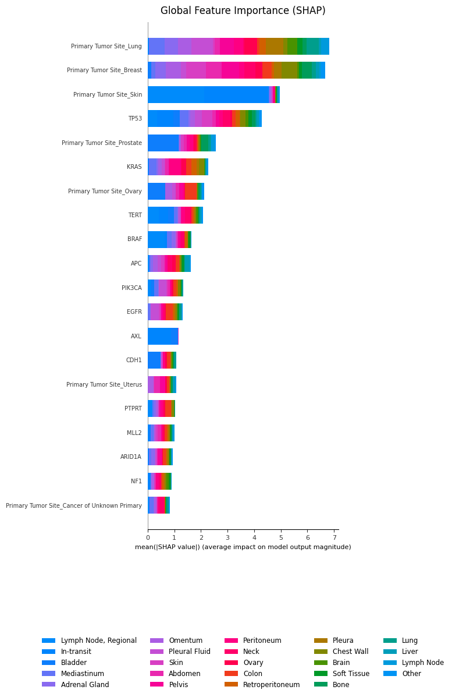
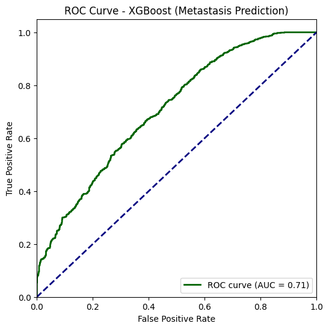
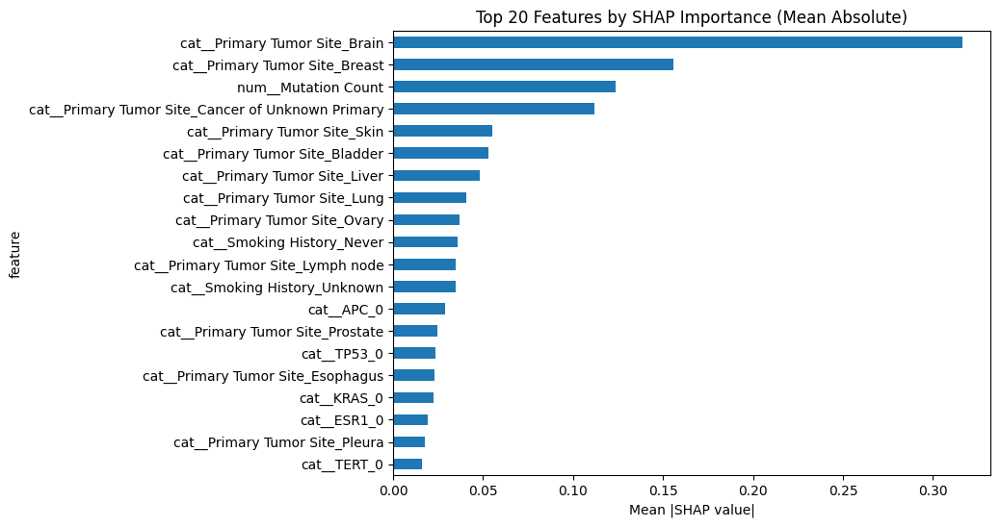

# Predicting metastasis and metastatic organotropism in malignancies using machine learning

Code behind my MSc thematic paper in Biomedical and Health Informatics at Mahidol University (2026).
The paper itself is not published here — this repository is the analysis: one notebook, the figures it
produced, and enough notes to reproduce the run.



## The question

Metastasis prediction is usually studied one cancer type at a time. This project asks whether a single
pan-cancer model can learn anything useful from primary tumour site and somatic mutation profile, under
two framings:

1. **Binary** — is this sample a primary tumour or a metastasis?
2. **Forward organotropism** — given a primary tumour, which organ does it metastasise to?

The thesis also runs a third task, **reverse prediction** (primary site from the metastatic site). That
one is not reproduced in this notebook; the notebook covers the forward and binary tasks.

The headline result is deliberately unglamorous. Whether a sample is metastatic is learnable to a
degree — AUROC **0.707** with XGBoost. Predicting the *specific* metastatic site is not: accuracy edges
past the majority-class baseline, but macro-F1 stays close to zero because the models collapse onto
liver, lymph node and lung and never predict most of the 24 classes. The ablation is there to show
which feature block carries that limited signal, not to claim a working clinical tool.

## What's in here

| Path | Contents |
| --- | --- |
| `notebooks/metastasis-organotropism-ablation.ipynb` | The analysis: loading, feature construction, ablation, models, SHAP |
| `figures/` | Figures exported from the original run, referenced below |
| `data/README.md` | Where the MSK-IMPACT files come from and what to name them |
| `requirements.txt` | Python dependencies |

The notebook is a cleaned copy of the one used for the thesis. Cell outputs, `pip install` lines and
Deepnote-specific cells were removed, hard-coded `/work/...` paths were replaced with a configurable
`data/` directory, and deprecated scikit-learn arguments (`multi_class`, `sparse=False`) were updated
so it runs on current versions. The numbers below are from the 2025 run recorded in the thesis; the
notebook has **not** been re-executed end to end after cleaning, so treat it as a readable, runnable
record rather than a fresh benchmark.

## Data

The study uses the public **MSK-IMPACT 2017** cohort (Zehir et al., *Nature Medicine*, 2017) via
cBioPortal: clinical attributes plus a mutation calls file in MAF format.

- Study: [`msk_impact_2017`](https://www.cbioportal.org/study/summary?id=msk_impact_2017)
- Bulk files: [cBioPortal datahub](https://github.com/cBioPortal/datahub/tree/master/public/msk_impact_2017)

The data is **not** redistributed here — it is large, it is versioned upstream, and it carries its own
terms of use. Drop the two files into `data/` (or point `MSK_DATA_DIR` elsewhere) as described in
[`data/README.md`](data/README.md). Everything in `data/` is git-ignored.

## Method

**Cohort.** 10,129 samples with both clinical and mutation data (27 clinical columns + 414 gene
columns). After restricting to samples with a recorded metastatic site: 4,486 cases and 143 distinct
site labels. Sites with fewer than 20 cases were merged into `Other`, leaving **24 classes**. The
largest is liver (1,048), then lymph node (833) and lung (525).

**Feature ablation.** Three feature sets, each trained and evaluated identically:

- primary tumour site only (one-hot),
- mutation status only (binary gene matrix pivoted from the MAF),
- both concatenated.

**Models.** Logistic regression and XGBoost for all three feature sets, then a TabTransformer over
categorical tokens (primary site plus the top 20 mutated genes per sample) and a small embedding MLP
that combines a learned primary-site embedding with the mutation vector. The thesis reports six
architectures across three tasks; this notebook is the subset above.

One wrinkle worth knowing before reading the table: the two neural models merge rare sites at a lower
threshold (fewer than 5 cases, not 20), which gives them **52 classes instead of 24**. Their accuracy is
therefore not strictly comparable with the logistic and XGBoost rows — they are answering a harder
version of the task.

**Evaluation.** 80/20 stratified split, `random_state=42`, 898 samples in the multiclass test set and
2,026 in the binary one. Accuracy, macro-F1, weighted F1, and the no-information rate (NIR, the
majority-class share) are reported together, because accuracy alone is misleading on a cohort this
imbalanced.

## Results

### Forward: metastatic site (24 classes, NIR 0.234)

| Model | Features | Accuracy | Macro F1 | Weighted F1 |
| --- | --- | ---: | ---: | ---: |
| Logistic regression | Primary site | 0.347 | 0.092 | 0.273 |
| Logistic regression | Mutations | 0.255 | 0.057 | 0.204 |
| Logistic regression | Combined | 0.323 | 0.109 | 0.280 |
| XGBoost | Primary site | 0.343 | 0.092 | 0.271 |
| XGBoost | Mutations | 0.252 | 0.072 | 0.204 |
| XGBoost | Combined | 0.318 | 0.115 | 0.278 |
| TabTransformer | Site + top-20 genes | 0.333 | — | 0.255 |
| Embedding MLP | Site + mutation vector | 0.240 | 0.010 | 0.140 |

<sub>Last two rows: 52-class label space, so not directly comparable with the 24-class rows above.</sub>





Primary site carries more signal than mutation status; adding mutations to site does not help, and
slightly hurts, on accuracy. Every model beats NIR by 1–11 points but predicts 3–5 classes out of 24,
which is what the near-zero macro-F1 reflects:



SHAP on the multiclass XGBoost model agrees: primary site dominates, with mutation features contributing
little beyond site identity.



### Binary: primary vs metastasis (2,026 test samples, 56% primary)

| Model | Accuracy | Weighted F1 | AUROC |
| --- | ---: | ---: | ---: |
| Logistic regression (balanced) | 0.627 | 0.629 | 0.688 |
| XGBoost (class-weighted) | 0.635 | 0.636 | **0.707** |




Here the mutation features do carry signal: SHAP ranks primary site first but puts mutation count and
several genes (APC, TP53, KRAS, ESR1, TERT) in the top 20, and the effect directions line up with what
is known about those genes — APC and KRAS pushing towards colorectal-type metastatic patterns, for
example.




## Reproducing

```bash
python -m venv .venv
source .venv/bin/activate
pip install -r requirements.txt

# put the two MSK-IMPACT files in ./data (see data/README.md)
jupyter lab notebooks/metastasis-organotropism-ablation.ipynb
```

Run the notebook top to bottom. Some cells depend on variables created earlier (`k`, `df_wide`,
`merged`, the fitted encoders), so out-of-order execution will break. Training the TabTransformer for
80 epochs on CPU is the slow part; everything else finishes in minutes.

Optional environment variables:

- `MSK_DATA_DIR` — where the two input files live (default `data/`)
- `MSK_OUTPUT_DIR` — where derived CSVs and the SHAP PNG are written (default `outputs/`)

## Limitations

Worth stating plainly, since the numbers are easy to over-read:

- **Sample-level split, not patient-level.** MSK-IMPACT contains multiple samples per patient. A
  patient-level grouped split would be stricter and would likely lower the scores; the thesis notes
  this as a limitation rather than correcting it.
- **The label is the biopsied site**, not a full metastatic map. A patient with liver and bone lesions
  may appear once, under one site.
- **Heavy class collapse.** Merging rare sites into `Other` makes the task tractable but hides exactly
  the rare-organotropism cases a clinical model would need to get right.
- **No external validation.** Everything is a single hold-out split of one cohort.
- **Modest ceiling.** AUROC 0.707 for binary status is a signal, not a triage tool, and site prediction
  is close to the baseline.

## Status and licence

The thesis is still being finalised, so the document, the defence slides and the committee material are
not in this repository. Code and figures are shared for reading and reference. No open-source licence
has been applied yet — if you want to reuse or build on this, please get in touch first.

Ching To Chung · MSc Biomedical and Health Informatics, Mahidol University, 2026
